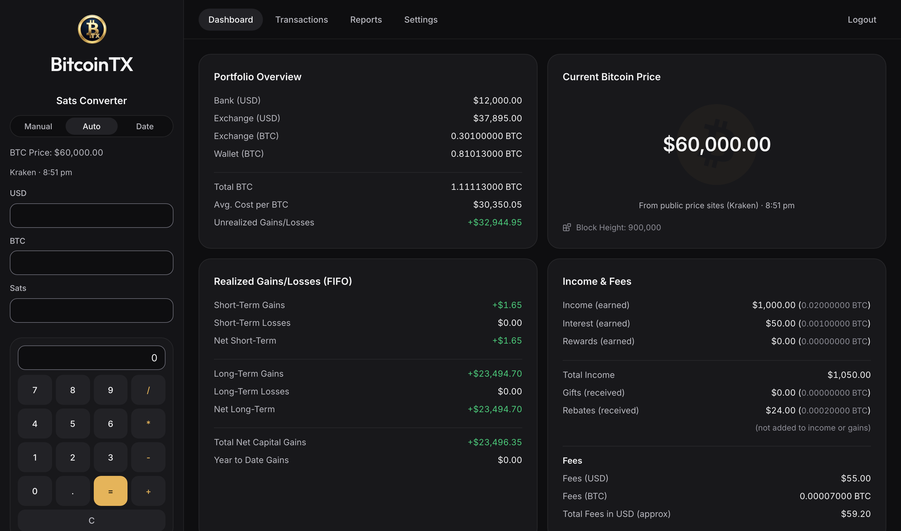
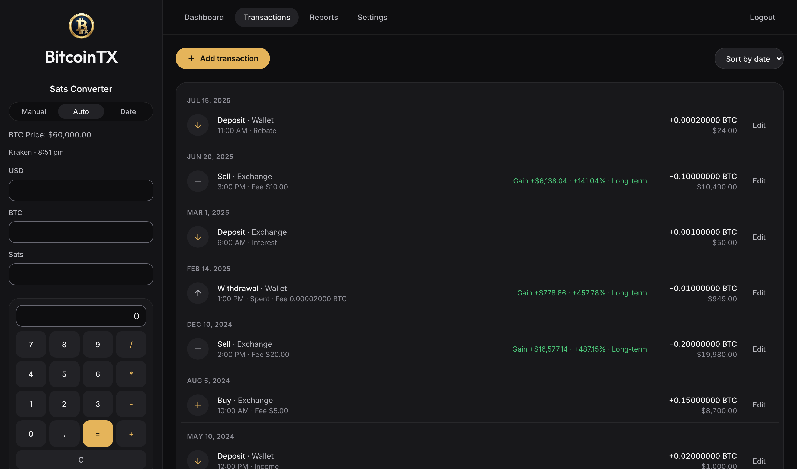
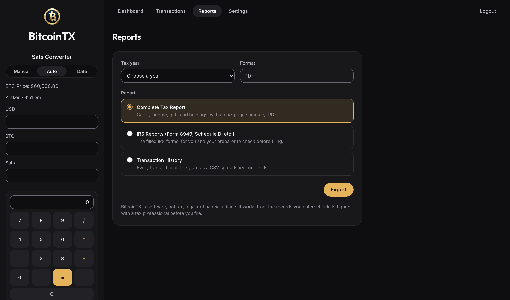
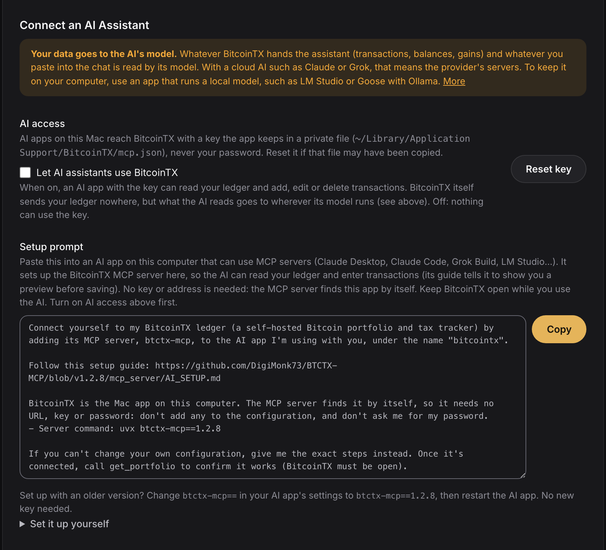

# BitcoinTX – Bitcoin Portfolio & Tax Tracker

A minimalist, self-hosted Bitcoin portfolio tracker and tax report generator
for **one self-custody wallet and one exchange account** (see [One wallet, one
exchange](#one-wallet-one-exchange)), with an **MCP server** so an AI
assistant can enter transactions for you. What changed in each release:
[docs/CHANGELOG.md](docs/CHANGELOG.md).

It tracks BTC and USD balances with **double-entry accounting**, computes
FIFO cost basis and capital gains per account, and prints IRS **Form 8949**
and **Schedule D**, including the Form 1099-DA boxes that start with tax year 2025.



| Transactions | Reports | Connect an AI Assistant |
|---|---|---|
|  |  |  |

<sub>Screenshots use a demo ledger.</sub>

## Features

- **Dashboard**: BTC holdings, USD balance, realized and unrealized gains
- **Transactions**: Deposit, Withdrawal, Transfer, Buy and Sell. Every edit
  or deletion, and every entry dated before your latest one, recalculates
  the whole ledger, so backdated entries come out right.
- **FIFO lots per account**: a transfer keeps each lot's acquisition date and basis;
  a consolidation (Wallet to Wallet, or between exchanges BitcoinTX counts as
  one) records only its network fee
- **Reports**: Form 8949 and Schedule D (filled, flattened PDFs), a complete
  tax report, and transaction history (PDF/CSV). When your broker's 1099-DA
  says something different for a sale, record that on the transaction and the
  right Form 8949 box follows. Each year's final IRS forms come in an update
  once the IRS publishes them; until then the IRS's draft of that year is a
  preview, marked DRAFT — DO NOT FILE (2026's until January 1, 2027).
- **Imports**: River CSV export, generic CSV (into an empty ledger), and the
  AI route below
- **AI entry (MCP)**: paste an exchange email or a wallet history, or type
  "moved 0.05 BTC to my Coldcard yesterday, fee 2k sats". The assistant
  previews the rows (duplicate check, fair market value, resulting gains) and
  saves them once you confirm. Use a local model if your data must stay on
  your computer ([below](#connect-an-ai-mcp)).
- **Ledger Review** (Settings): a read-only list of saved entries worth a
  second look, including every figure a recalculation would change
- **Your own node for prices**: point BitcoinTX at your own Mempool
  (Settings → Privacy & Network) and the live price, block height and newer
  prices come from it; no public site is contacted unless you tick **If it
  can't answer, ask public price sites**. Your Mempool has hourly
  prices only from when it began recording. A home server's https address
  (a StartOS server's `.local` one from the Mac app, or its LAN IP address)
  works too: the card offers **Trust this server** for its own certificate,
  for that address only. A fresh install
  contacts nothing until you choose where prices come from (your own
  Mempool, public price sites, or Nobody)
- **Prices at the hour, without giving away your dates**: BitcoinTX values
  a transaction at the price when its hour began, from its own stored
  history. When your choice allows public price sites, that hourly history
  (2013 on) comes in one download from Bitstamp. The download is the same
  for every install and checked against fingerprints that come with
  BitcoinTX. After that, only the newest hours come, in fixed blocks, so no
  request ever names one of your dates. Where no hour is known, the day's
  price is used. BitcoinTX records one price per hour, so it won't always
  match a chart of one exchange at another moment. A VPN or Tor hides your
  IP address from the sites. Through Tor, Bitstamp currently refuses
  BitcoinTX's requests for the price history, so the Dashboard asks once
  whether to download it without Tor: only Bitstamp's history downloads,
  the same for every install and naming none of your dates, would show
  Bitstamp your address; the live price stays on Tor. You can change the
  answer in Settings. With No, use your own Mempool for newer values, or
  type them
- **Tax timezone** (Settings): decides which tax year a late-night Dec 31
  transaction lands in, the dates on Form 8949, and when a lot turns long-term
- **Encrypted backup/restore**, single-user login

How each part works, the same wherever BitcoinTX runs:
[docs/USING.md](docs/USING.md).

## One wallet, one exchange

> [!IMPORTANT]
> BitcoinTX tracks one self-custody wallet and one exchange account. Since
> 2025, IRS rules require cost basis to be figured wallet by wallet and
> account by account, so if you use multiple wallets or exchange accounts,
> BitcoinTX's gains can differ from what the rules give: keep separate
> records for each, or ask your tax preparer.

BitcoinTX keeps it simple on purpose: one self-custody **Wallet**, one
**Exchange** (USD and BTC) and one **Bank**. The two bitcoin accounts, Wallet
and Exchange, each keep their own FIFO lots. That fits someone who keeps their
bitcoin in one wallet and buys and sells through one exchange.

Multiple wallets or exchanges all go into those two accounts. The rule is
Treas. Reg. §1.1012-1(j), from January 1, 2025, with Rev. Proc. 2024-28 for
coins held on that date. With multiple wallets, BitcoinTX may figure a sale
from one wallet with the cost and purchase date of coins that were in
another. Multiple wallets and exchanges, each with its own lots, are planned
for BitcoinTX 2.0 ([#86](https://github.com/DigiMonk73/BTCTX-MCP/issues/86);
see [Versions](#versions)).

## Versions

1.2.9 is the stable version of BitcoinTX 1.x, and 1.2.10 its first
maintenance update. Until 2.0 replaces it, 1.x gets maintenance updates: bug
and security fixes, each year's IRS forms and the price history's updates,
and the few small improvements already planned for it
([roadmap](docs/ROADMAP.md)).

New features go into BitcoinTX 2.0, now in the works, which adds multiple
wallets, exchanges and bank accounts, each wallet and exchange with its own
cost-basis lots ([#251](https://github.com/DigiMonk73/BTCTX-MCP/issues/251)).
Because 2.0 changes how the ledger is stored, it's tested first on GitHub
pre-releases, alphas and then betas, for as long as it needs. Then 2.0 is
released here, replacing 1.x, and reaches StartOS through Start9's Community
Beta. We don't promise dates; until then, the latest 1.x is the version to
use for your records.

### Trying 2.0 before it's released

Anyone who chooses may try 2.0's pre-releases: the first is
[v2.0.0-alpha.1](https://github.com/DigiMonk73/BTCTX-MCP/releases/tag/v2.0.0-alpha.1),
and the later ones are on the [releases page](https://github.com/DigiMonk73/BTCTX-MCP/releases),
marked **Pre-release**. They're for testing and may have bugs. An alpha, the
earliest stage, is only for trying 2.0, never for your real records: try it
with a test ledger or a copy of your records, and keep 1.x for your records.
Nobody gets one as an update: the Mac app's download, Docker's `:latest` and
Start9's store stay on 1.x.

- **Mac:** a separate app, **BitcoinTX Preview** (every alpha and beta),
  installed beside BitcoinTX with its own ledger, folder and port: your
  BitcoinTX and its ledger are never opened. For now it has BitcoinTX's
  icon: tell them apart by the name, **BitcoinTX Preview**
  ([#670](https://github.com/DigiMonk73/BTCTX-MCP/issues/670)). It starts
  with an empty ledger; to try your records in it, download a backup in
  BitcoinTX (Settings, Backup & Restore) and restore it in BitcoinTX
  Preview.
- **StartOS:** sideloaded, it updates your BitcoinTX in place. **Make a
  StartOS backup of BitcoinTX first**, and keep it: to go back to 1.x,
  uninstall BitcoinTX (which deletes its data) and restore that backup.
  While your BitcoinTX runs a pre-release, StartOS offers it no 1.x update
  until 2.0 is out: fixes, security fixes included, come in the next
  pre-release.
- **Docker:** each pre-release has its own image tag (`:v2.0.0-alpha.1`,
  never `:latest`). Start it on a new volume and restore a backup into it.
  Started on your 1.x volume, it upgrades that ledger, and going back takes
  the steps in its [Going back to 1.x](https://github.com/DigiMonk73/BTCTX-MCP/blob/v2.0.0-alpha.1/docs/MAINTENANCE.md#going-back-to-1x).
- **An AI:** each pre-release's Settings (Connect an AI Assistant) gives the
  setup for its own connector (`btctx-mcp==2.0.0a1` for alpha.1), named
  `bitcointx-preview`. On StartOS your `bitcointx` entry is updated instead:
  set it back to your 1.x version if you go back.

What you enter in a pre-release can't go back to 1.x: 1.x can't read a 2.0
database or backup. Report what you find in [a new issue](https://github.com/DigiMonk73/BTCTX-MCP/issues/new/choose):
the "2.0 alpha or beta report", or, until GitHub lists it, a Bug report
whose title starts with the pre-release's name (for example
"2.0.0-alpha.1:"). Show the problem on a test ledger, never your real data;
report a security problem privately, as [SECURITY.md](SECURITY.md) explains.

## Install

Every [release](https://github.com/DigiMonk73/BTCTX-MCP/releases/latest) has
a macOS app, a StartOS package and a Docker image.

To check a file you downloaded from a release, save that release's
`SHA256SUMS` in the same folder and run
`shasum -a 256 -c --ignore-missing SHA256SUMS` there (on Linux,
`sha256sum -c --ignore-missing SHA256SUMS`): your file should say `OK`.
With the [GitHub CLI](https://cli.github.com), signed in,
`gh attestation verify <file> -R DigiMonk73/BTCTX-MCP --signer-workflow DigiMonk73/BTCTX-MCP/.github/workflows/release.yml`
also checks that this repository's release workflow built it.

### macOS app

Download `BitcoinTX-macOS.dmg` from the latest release and drag BitcoinTX to
Applications. It runs on Macs with Apple silicon (M1 or later); on an Intel
Mac, use Docker. The app is not signed by Apple: the first time,
Control-click it and choose **Open**; on macOS 15 or later, open it once,
then go to **System Settings → Privacy & Security** and click **Open
Anyway**. To build it yourself: `./desktop/build-mac.sh`.

See [docs/MACOS_DESKTOP_APP.md](docs/MACOS_DESKTOP_APP.md). The app keeps its
data in `~/Library/Application Support/BitcoinTX`. While it's open it serves
its window from `http://127.0.0.1:8765`, which is also the address the MCP
server uses.

### Docker

```bash
docker run -d -p 127.0.0.1:8080:80 -v btctx-data:/data ghcr.io/digimonk73/btctx-mcp:latest
# open http://localhost:8080
```

This makes BitcoinTX reachable from this computer only. The container speaks
plain HTTP: to use it from other devices, put it behind HTTPS (a reverse
proxy such as Caddy) rather than publishing `-p 8080:80`, which sends your
password and ledger unencrypted across your network.

Images are amd64 and arm64; pin a version with `:vX.Y.Z`. To build it
yourself: `docker build -t btctx .`

BitcoinTX runs as its own user in the container, `btctx` (uid 10001), never
as root. At a start the image gives `/data` to that user if anything in it
isn't theirs, then drops to it, so a volume an older version made keeps
working. A folder of yours mounted at `/data` (`-v /some/folder:/data`)
becomes uid 10001's too. With `DATABASE_FILE` set elsewhere, its folder must
be a volume or mounted folder itself (a subfolder of one isn't handed over:
give it to uid 10001 yourself). Maintenance commands run as that user:
`docker exec -u btctx <container> python -m backend.cli …`. If you drop
capabilities (`--cap-drop ALL`), keep CHOWN, DAC_OVERRIDE, SETUID, SETGID and
NET_BIND_SERVICE. Started with `--user`, the image runs as the user you give
and leaves `/data` as it is, so it must be that user's.

### StartOS

BitcoinTX needs StartOS 0.4.0.2 or later. Start9 builds the package from
[Start9-Community/BTCTX-StartOS](https://github.com/Start9-Community/BTCTX-StartOS)
and publishes each release first to its **Community Beta** registry, then,
once tested there, to its **Community Registry**:

1. In StartOS, open **Marketplace**, click **Switch** under the registry's
   name and choose **Community Registry**
   (`https://community-registry.start9.com`). To get each release as soon
   as it's out, add `https://community-beta-registry.start9.com` there
   instead ([Start9's guide](https://docs.start9.com/start-os/alternative-registries.html)).
2. Choose **BitcoinTX** and click **Install**. New versions then show in the
   **Updates** tab ([Updating](https://docs.start9.com/start-os/updating.html)).
3. Follow BitcoinTX's **Instructions** in StartOS
   ([startos/instructions.md](startos/instructions.md)): run **Set Login
   Credentials** (it shows your login once) and **Price Source & Privacy**,
   then open the Web UI. "First login" below is for the Mac app, Docker and
   source installs.

Services on Start9's community registries aren't maintained or supported by
Start9: report BitcoinTX problems here ([Reporting problems](#reporting-problems)).

Or sideload it: download `btctx.s9pk` from the
[latest release](https://github.com/DigiMonk73/BTCTX-MCP/releases/latest) and
upload it under **Sideload**. To update a sideloaded copy, sideload the next
release's file the same way. Package details: [startos/README.md](startos/README.md).

### From source

Requires Python 3.11+ and Node.js 22.13+ (Docker and CI use Node 24).

```bash
pip install --require-hashes -r backend/requirements.txt
(cd frontend && npm ci && npm run build)
uvicorn backend.main:app --port 8000     # open http://localhost:8000
```

A `.env` file is optional; see [.env.example](.env.example).

### First login

A fresh install starts with the account `admin` / `password`, and the first
screen (**Create account**) has you set your own username and password (at
least 12 characters). On Docker or a source install it also asks for a
one-time **setup code**, so nobody else on your network can claim the app
first: it's in the log (`docker logs <container>`) and in `setup-code.txt` in
the data folder (`/data`), and it's deleted once you've set up the account.
Until then, the default login doesn't work without it either (an older
install still on admin/password: the login page asks for the code; then
change the password in Settings, your data stays). The Mac app needs the
code too, and its window fills it in: its first screen is **Choose your
username and password**, and your transactions are kept (an older Mac
install still on admin/password sees it too). On StartOS this screen never
appears: run the **Set Login Credentials** action, which creates the login
(`admin` and a random password) and shows it once.

After that, BitcoinTX asks "Where should BitcoinTX get Bitcoin prices?"
(your own Mempool, public price sites, or Nobody); nothing is contacted
before you choose.

## Connect an AI (MCP)

In BitcoinTX, open **Settings → Connect an AI Assistant**, copy the setup
prompt and paste it into your AI app (Claude Code, Claude Desktop, Grok Build
or any app that runs MCP servers on your computer). The AI sets itself up
following [mcp_server/AI_SETUP.md](mcp_server/AI_SETUP.md). The MCP server
uses an **AI key**, never your password. With the Mac app no key or address
goes anywhere: the app writes a private key file the MCP server reads by
itself. Or by hand, for the Mac app (Settings gives the same command with
your version filled in):

```bash
claude mcp add --scope user bitcointx -- uvx btctx-mcp==X.Y.Z
```

The MCP server ([`btctx-mcp` on PyPI](https://pypi.org/project/btctx-mcp/)) is
pinned to your BitcoinTX release (`==X.Y.Z`), so your AI app runs exactly that
version and fetches nothing new on its own. `uvx` downloads it from PyPI
the first time (PyPI sees your IP address and the version; it's cached
after that). After you update BitcoinTX, every tool reply says so until you
change the version in the command.

Docker and StartOS use `BTCTX_URL` and `BTCTX_AI_KEY` instead: create the key
in the same Settings section (it's shown once) and paste it into your AI app's
configuration yourself, not into the chat.

[mcp_server/README.md](mcp_server/README.md) covers the Claude Desktop
config, Docker and StartOS addresses, TLS options, and example prompts.

**Privacy: the AI's model sees your ledger.** Once connected, the model reads
what the tools return (transactions, balances, cost basis, gains) and whatever
you paste. With a cloud AI (Claude, Grok and most others) that goes to the
provider's servers. To keep it on your computer, use an app that runs a local
model, such as [LM Studio](https://lmstudio.ai/) or
[Goose](https://goose-docs.ai/) with [Ollama](https://ollama.com/), or use a
cloud AI only with a test ledger. Setup for local models:
[mcp_server/README.md](mcp_server/README.md#privacy-cloud-or-local-model).

- **Optional.** Nothing AI-related runs until you add the MCP server to an AI
  app, and you choose which app and model.
- **BitcoinTX sends your ledger nowhere itself.** The MCP server talks only to
  your BitcoinTX; the model sees what the tools return.
- **Off by default.** The key works only after you turn on **Settings →
  Connect an AI Assistant → Let AI assistants use BitcoinTX**; turn it off to
  stop the AI.
- **What the key can do:** read the ledger, add, change or delete single
  entries, recalculate the ledger, and make a backup copy on the server. It can't log in, change your
  password, restore a backup, import files or delete everything. In the Mac
  app it works only from that Mac; on Docker and StartOS you can revoke it or
  make a new one in Settings at any time.

**Set up an AI with Docker or StartOS before AI keys existed?** Your AI app's
settings file holds your BitcoinTX password in plain text, and BitcoinTX no
longer accepts it for AI access. (1) In **Settings → Connect an AI
Assistant**, turn on AI access and create an AI key; (2) in your AI app's
settings, replace `BTCTX_PASSWORD` (and `BTCTX_USERNAME`) with `BTCTX_AI_KEY`
set to that key, and delete the password; (3) change your BitcoinTX password
(Settings → Reset Username & Password), or on StartOS run **Set Login
Credentials**, because the old one sat in that file. Mac app users: nothing
to do.

## Upgrading

1. Download an encrypted backup (Settings → Backup & Restore).
2. Start the new version. It upgrades the database automatically and keeps a
   copy of the old one in a `backups` folder next to it.
3. Open **Settings → Ledger Review**. Without changing anything, it lists
   every figure a recalculation would change (old → new) and saved entries
   worth a second look, such as income and rebate deposits with a $0 or
   blank value, and Inherited deposits without a date of death. After them
   comes a reminder, not an error: My BTC and Gift
   deposits without a date originally acquired, counted from their deposit
   date until you add one. The release notes say which to fix.
4. Click **Settings → Recalculate Ledger** when you agree.
5. Check your **Tax Timezone** in Settings.
6. If you use the AI connector: in your AI app's settings, change
   `btctx-mcp==<old version>` to `btctx-mcp==<new version>`, then restart
   the AI app. No new key, nothing to set up again. If you forget, every
   connector reply tells you. Where to change it in each app:
   [Updating](mcp_server/README.md#updating).

From v0.7 or earlier, transfer fees, sale proceeds and the one-year holding
period are calculated differently; from before v0.9.2, withdrawal fees and
Lost withdrawals are; from v0.9.2 to v1.2.7, a spend's network fee is (it now
comes off the spend's proceeds); up to v1.2.8, each piece of a lot had its
cost rounded to the cent on its own, and an old withdrawal of a purpose
BitcoinTX doesn't list counted as a sale (a recalculation moves a cent or two
on most ledgers, more on one started before 0.9.2). Either way, stored gains can change. The
[CHANGELOG](docs/CHANGELOG.md) lists what changes existing figures in each
release.

## Yearly IRS forms

`python scripts/irs_new_year.py 2026` downloads the year's final Form 8949
and Schedule D, checks every field the app fills, and runs the form tests. A
weekly GitHub workflow opens an issue when the IRS publishes new drafts or
final forms. Before the final forms, `python scripts/irs_new_year.py
--draft --ship` ships the IRS's drafts as the year's preview. See
[docs/IRS_ANNUAL_FORM_UPDATE.md](docs/IRS_ANNUAL_FORM_UPDATE.md).

## Development

```bash
pip install --require-hashes -r backend/requirements.txt
pip install -r requirements-dev.txt ./mcp_server
make hooks        # pre-push gate: lint, static checks, fast tests, smoke test
make test         # full hermetic suite (temp DB, stubbed prices, no network)
make e2e          # click-through tests in real browsers (Playwright)
make check        # lint, full tests, smoke test, dependency audit (CI adds the click-through tests, StartOS, Docker and macOS)
```

Testing guide: [docs/TESTING.md](docs/TESTING.md). Architecture and
conventions: [AGENTS.md](AGENTS.md).

| Layer | Tech |
|---|---|
| Frontend | React + TypeScript + Vite |
| Backend | FastAPI + SQLAlchemy + SQLite |
| PDFs | pypdf (IRS form filling), ReportLab (reports) |
| BTC prices | Your Mempool, or public sites: the hourly history (2013 on) in one download from Bitstamp, checked against fingerprints shipped with BitcoinTX, then newer hours from Bitstamp in fixed blocks; where no hour is known, the day's price (Bitstamp's daily history, then the latest days from Bitstamp, else Kraken); live price from Kraken, else Bitstamp |
| Block height | Your mempool server, or Blockchain.info, Blockstream, mempool.space |
| AI | MCP server (Python `mcp` SDK, stdio) |

## Disclaimer

BitcoinTX is software, not tax, legal or financial advice. It works from the
records you enter: check its figures with a tax professional before you
file. It's provided as is, without warranty ([MIT License](LICENSE)). You're
responsible for your records and your tax return.

## Reporting problems

- **A bug or a wrong figure:**
  [open an issue](https://github.com/DigiMonk73/BTCTX-MCP/issues/new/choose).
  - The [open bugs](https://github.com/DigiMonk73/BTCTX-MCP/issues?q=is%3Aissue+is%3Aopen+label%3Abug)
    are the known issues. A new report is labelled `unconfirmed` until
    it's reproduced.
  - Those that can affect a tax figure are labelled
    [`tax-figures`](https://github.com/DigiMonk73/BTCTX-MCP/issues?q=is%3Aissue+is%3Aopen+label%3Atax-figures)
    and fixed first.
- **A security problem:** report it privately, as [SECURITY.md](SECURITY.md)
  explains. Never in an issue.
- **Never post personal data:** issues are public.

Every bug we find ourselves is filed publicly too. Its fix comes with a test,
and when a fix changes figures, the release notes say what was wrong and what
to do. Contributing: [CONTRIBUTING.md](CONTRIBUTING.md).

## Support BitcoinTX

BitcoinTX is free and stays free. If it helps you and you'd like to send a
few sats, its Lightning address is **digimonk73@strike.me** (any Lightning
wallet), or use the [tipping page](https://strike.me/@digimonk73). Thank you.

## License

MIT, see [LICENSE](LICENSE).
